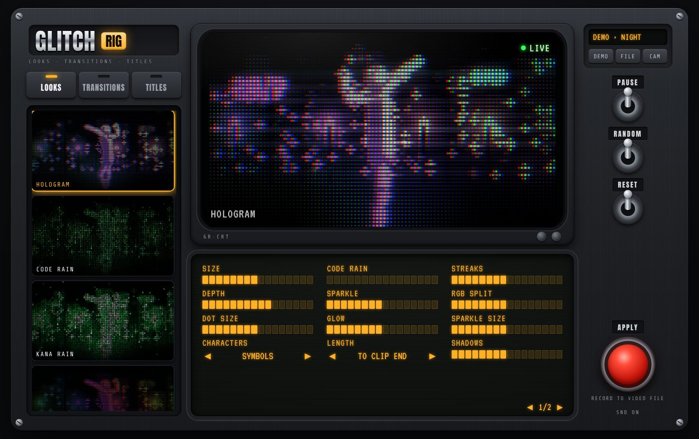

# GLITCH RIG

Panel pre **After Effects** a **Premiere Pro** (macOS aj Windows). Každý efekt je karta:
vyberieš ju, doladíš ju na displeji a stlačíš **APPLY**. Panel efekt vyrenderuje na vybraný
klip a výsledok položí na stopu nad ním.



Rovnaký `index.html` beží aj v obyčajnom prehliadači ako demo. APPLY tam efekt nahrá do
video súboru (.webm).

## Čo je v ňom

### LOOKS (44)

| Rodina | Karty | Čo robí |
|---|---|---|
| Dot matrix | HOLOGRAM, PRISM ORBS, GOLD ORBS, CHROME ORBS, LAVA ORBS, GLITTER, GHOST ICE, STARDUST, HEAT MAP, SCANNER, LED WALL | Obraz sa poskladá z buniek: bodky, tieňované guľôčky alebo LED štvorce. Farbu určuje paleta (holo dúha, zlato, láva, termo…). K tomu glow, svetelné šmuhy, RGB split a trblietky. |
| Znaky | CODE RAIN, KANA RAIN, BINARY, ASCII, ASCII MONO, ASCII FIRE, RED KANA, VOID | Obraz zo znakov (ASCII podľa jasu, katakana, binárka, kód) a padajúci „code rain“. |
| Slová | WORD WALL, GOLD WORDS | Obraz poskladaný z tvojho textu (pole WORDS). |
| Farebné looky | NIGHT VISION (s REC HUD), THERMAL, INFRARED, XEROX, BLACKLIGHT, CRT TV, BITCRUSH, VHS TAPE, CORRUPTED, TOXIC, CYANIDE, SUNBURN, AMETHYST, LIQUID CHROME, MODULATION | Hotové farebné a glitch spracovania s jednotnými ovládačmi (amount, farba, kontrast, šum, glitch…). |
| Trip | FULL TRIP, ACID MELT, ACID WARP, ACID TRIP | Dýchajúca deformácia, topenie, posun farieb, geometrický vzor na plochách a stopy (tracers). Sila ide po krivke: STARTS AFTER → COME UP → PEAK → COME DOWN. |
| Klony | CLONE TRAIL, CHROMA ECHO | Staršie snímky sa vrstvia späť (len tam, kde je pohyb), sfarbené a posunuté. Pri echo má každý RGB kanál iný čas. |
| BLOB TRACK | – | Nájde body záujmu (pohyb, svetlá, tiene, kontrast) a sleduje ich: boxy, spojovacie čiary, kódy a súradnice. Vnútro boxov môže byť invert, termo, zoom, pixel alebo night vision. |
| HAND FRAME | – | Priestor medzi tvojimi rukami sa stane hľadáčikom kamery s vlastným lookom (NV, IR, termo…) a REC HUD. Ruky hľadá MediaPipe (potrebuje internet). Bez neho rám sleduje pohyb (AUTO) alebo stojí v strede (CENTER). |

### TRANSITIONS (18)

- **DATAMOSH MELT / BLOOM / NEON / ACID.** Je to skutočný datamosh: GPU odhadne pohybové
  vektory prichádzajúceho klipu (block matching) a nimi rozmazáva posledný snímok
  odchádzajúceho klipu, kým sa nový obraz nepresype. Nastavíš dĺžku, intenzitu, zdroj pohybu
  (OWN / SWIRL / SHAKE), blend, veľkosť blokov, trhané snímky, rýchlosť farieb a záblesky.
- **FLASH CUT, STATIC, STROBE, MOSAIC, PULSE RING, CHROMA SPLIT, WHIP PAN, ZOOM PUNCH,
  SLICE TEAR, RIPPLE, HYPERDRIVE, PHANTOM SHIFT, FILM BURN, GLITCH BLOCKS**: strih je
  v strede prechodu.

### TITLES (10)

FUZZ, LIQUID METAL, NEON SIGN, INTERLACE, BRIAR, SMOKE, ICE, GOTHIC, CANDY, TAPE GLOW.
Napíšeš text do poľa TYPE a nastavíš veľkosť, množstvo, farbu, tint, blur, hue, saturáciu,
jas a kontrast. Titulok sa renderuje s priehľadným pozadím a pri štarte a konci sa
„zaglitchuje“.

### Ovládanie

- **Displej:** 16-dielne pásiky (klik, ťahanie, koliesko, šípky), voľby ◀ ▶ a farebné
  políčka. Ak má karta viac ovládačov, prepínaš strany 1/2.
- **PAUSE / RANDOM / RESET:** zastaví náhľad, náhodne nastaví ovládače, vráti predvolené
  hodnoty.
- **LENGTH:** do konca klipu alebo 1/2/3/5/10 s.
- Klávesy: medzerník = pauza, R = random, ↑/↓ = ďalšia karta.

## Ako APPLY funguje v AE a Premiere

1. `jsx/host.jsx` zistí cieľ:
   - **Look:** vybraná vrstva v AE alebo vybraný klip v Premiere, inak klip pod playheadom.
   - **Prechod:** v AE vyber dve vrstvy pri strihu. V Premiere daj playhead na strih medzi
     dvoma klipmi.
   - **Titulok:** začína na pozícii playheadu.
2. Panel otvorí zdrojové video zo súboru. Snímok po snímku ho prepočíta tým istým
   WebGL efektom, ktorý vidíš na obrazovke, v rozlíšení kompozície alebo sekvencie.
   Výsledok zapíše ako PNG sekvenciu do `Dokumenty/GlitchRig/renders/…`.
3. Sekvencia sa importuje do priečinka alebo binu **Glitch Rig** so správnym fps.
   V AE ide ako vrstva nad tvoju vrstvu. V Premiere ide na prvú voľnú stopu nad klipom
   (ak voľná nie je, pridá sa nová).

Ak Chromium v paneli video nevie dekódovať (napr. ProRes), panel si snímky vyžiada
priamo od AE (`saveFrameToPng`) alebo Premiere (`exportFramePNG`).
Tieto snímky sú z časovej osi, takže obsahujú aj vrstvy nad klipom. Pri prechode sa A berie
len pred strihom a B až od strihu (za hranou sa drží krajný snímok).

## Inštalácia

**macOS:** `bash install/install-mac.sh`
**Windows:** dvojklik na `install\install-win.bat`

Skript zapne `PlayerDebugMode` (bez neho sa nepodpísané panely nenačítajú) a skopíruje panel
do priečinka CEP extensions. Potom reštartuj AE alebo Premiere a otvor
**Window → Extensions → Glitch Rig**.

Požiadavky: After Effects 2020 (17.0)+ alebo Premiere Pro 2020 (14.0)+ a grafická karta
s WebGL2.

Ladenie: s `.debug` sú DevTools na `http://localhost:8088` (AE) a `http://localhost:8089`
(Premiere).

Distribúcia a predaj: zabaľ priečinok do podpísaného `.zxp` (Adobe `ZXPSignCmd`
s certifikátom). Podpísaný balík nepotrebuje PlayerDebugMode.

## Vyskúšanie v prehliadači

```bash
cd glitch-rig
python3 -m http.server 8000
# otvor http://localhost:8000
```

Zdroj prepneš tlačidlami DEMO (dve vygenerované scény, netreba žiadne video), FILE
(vlastné video, funguje aj drag & drop) a CAM (webkamera, vhodná pre HAND FRAME). Pri
prechodoch nahráš druhý klip cez CLIP B….

## Štruktúra

```
CSXS/manifest.xml      CEP manifest (AEFT + PPRO, Node.js zapnutý)
index.html, css/       panel (všetok „hardvér“ je čisté CSS)
js/core/               WebGL2 engine, finálny pass (glow/streaks/RGB/scanlines…), glyph atlas, zdroje
js/effects/            dotmatrix, grades, trip, clones, blob, handframe, mosh, transitions, titles
js/catalog.js          všetky karty a ich ovládače
js/player.js           živý náhľad, náhľadové obrázky kariet, offline renderer pre APPLY
js/host.js             most do AE/Premiere (CEP + Node) a nahrávanie v prehliadači
jsx/host.jsx           ExtendScript: výber cieľa, import a umiestnenie, export snímok
install/               inštalačné skripty
```

## Stav a obmedzenia

- **Otestované:** všetkých 72 kariet sa v Chromiu vykreslí bez chýb. APPLY prešiel celý
  (výber cieľa → dekódovanie → render → PNG → umiestnenie) proti simulovanému Premiere
  hostu pre look, datamosh, bežný prechod aj titulok.
- **Neotestované v reálnom AE/Premiere** (tu nie sú k dispozícii). Pred ostrým použitím
  vyskúšaj ExtendScript časti na svojom stroji: hlavne `overwriteClip`,
  `setOverrideFrameRate`, `addTracks` cez QE a záložný export snímok.
- Rýchlosť klipu (Premiere), stretch aj time remap vrstvy (AE) sa sledujú snímok po snímku.
  Obrátené prehrávanie (reverse) zatiaľ nie je overené. Zdroj sa natiahne na veľkosť
  sekvencie alebo kompozície.
- HAND FRAME načítava model z CDN, takže v paneli potrebuje internet. Bez neho prejde do
  režimu AUTO.

Kód aj grafika sú pôvodné. Inšpiráciou bol iba druh produktu (panel s kartami, náhľad,
displej s parametrami, APPLY). Nekopíruje sa cudzí kód, obrázky, videá ani značka.
